

 
 

<picture>
  <source media="(prefers-color-scheme: dark)" srcset=".github/assets/wordmark-on-dark.svg">
  
</picture>

### The next-gen Postgres client for Mac

Fast, beautiful and built for people who live in their database. Redis and Valkey too.

 

 
 

 
 

<a href="https://github.com/mccannjustin17/tachyon-releases/blob/main/.github/assets/tachyon-film.mp4">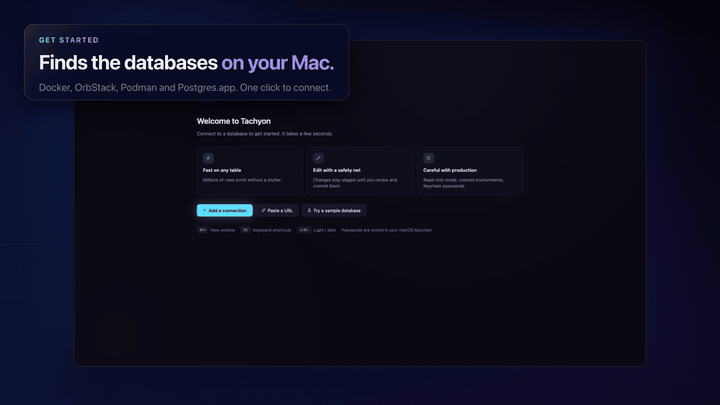</a>

<a href="https://github.com/mccannjustin17/tachyon-releases/blob/main/.github/assets/tachyon-film.mp4">▶ Watch the full film with sound (73 seconds)</a>

 
 

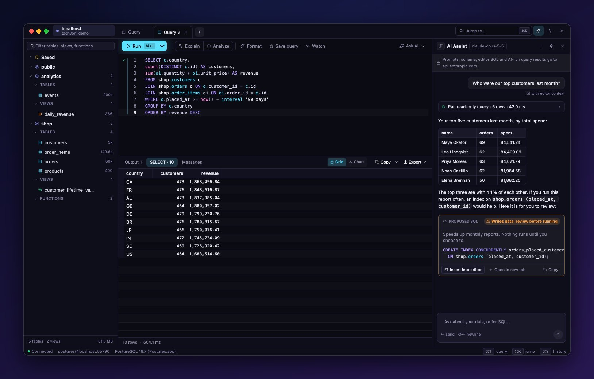

 

## Why Tachyon

<table>
<tr>
<td width="50%" valign="top">

### ⚡ Built for speed
Opens in a blink and stays out of your way. Results stream in the moment they're ready, and tables with millions of rows scroll without a stutter. Sorting, filtering and search run on the server, and Tachyon uses almost no CPU while idle.

</td>
<td width="50%" valign="top">

### ✍️ Write SQL faster
Autocomplete that knows your schema and writes whole joins for you. Mistakes are underlined as you type, with one-key fixes, docs on hover and ⌘-click to jump to any definition.

</td>
</tr>
<tr>
<td width="50%" valign="top">

### 🔍 See your data
Filter any column in a click, profile what's inside it, and turn any result into a chart or a map. Query plans point straight at the slow parts, and your schema is drawn as a diagram.

</td>
<td width="50%" valign="top">

### 🛡️ Edit with confidence
Change values inline and review every edit as SQL before it's saved. Read-only connections, colored environments and passwords in your macOS Keychain keep production safe.

</td>
</tr>
<tr>
<td width="50%" valign="top">

### ✨ AI that respects your data
Ask questions in plain English, or explain, optimize and fix the query in front of you. Use Anthropic, OpenAI, Gemini or a private model on your Mac. Nothing changes without your OK.

</td>
<td width="50%" valign="top">

### 🍎 At home on your Mac
Light and dark, beautiful themes, native menus and familiar shortcuts. A command palette for everything, arrow keys everywhere, and a size that fits your screen.

</td>
</tr>
</table>

 

## An editor that knows your schema

Type `JOIN ord` and Tachyon offers the whole join, `ON` clause included, from your foreign keys. Every table, column and function completes with its type, and docs appear on hover.

- **Run what you mean.** ⌘↵ runs the statement under your cursor, a selection or the whole file, and a run button sits beside every statement. Named `:parameters` ask for their values.
- **Catch mistakes early.** Errors are underlined as you type, with one-key fixes.
- **Navigate like code.** ⌘-click or F12 to go to a definition, find every use, and rename a table or column: Tachyon writes the `ALTER` statement for you and can update your open editors to match.
- **Format** with one key, **split** the editor side by side, and **watch** a query to re-run it on a timer.
- **Edit functions and procedures** in place. Tachyon shows what changed on the server before saving them back.

 

## Find what you're looking for

Open any table and it's ready at once, even with millions of rows. Search across every column, filter by a column's most common values, or write a `WHERE` clause by hand. The inspector shows the selected row in full and profiles any column: row count, nulls, distinct values, range and top values.

Foreign keys are links: click one to open the row it points to. Copy cells straight into a spreadsheet, or export results as CSV, TSV, JSON, Excel, Markdown, SQL inserts or GeoJSON.

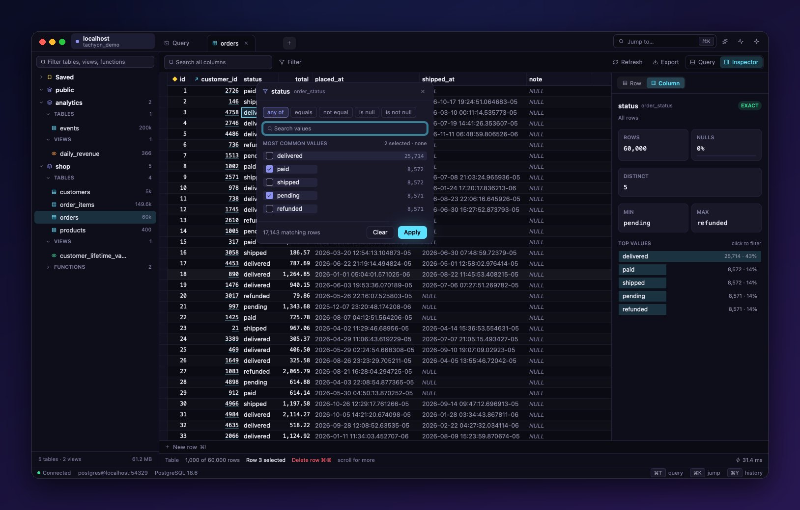

 

## Edit with a safety net

Double-click a cell and type. Every change is staged and highlighted until you commit, and the review shows each edit as before and after, or as the exact SQL that will run. Add and delete rows, set values to NULL, or paste a block of cells from a spreadsheet. Discard it all with one key.

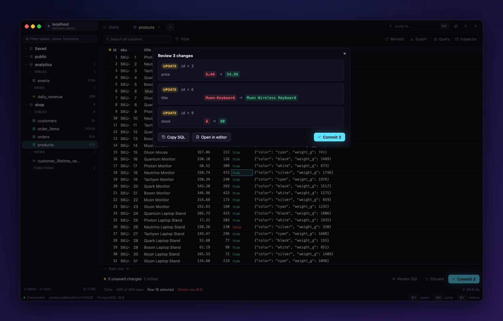

 

## Find the slow parts

**Explain** and **Analyze** draw the query plan as a tree, with bars that show where the time really went and flags on bad row estimates. Analyze always rolls back, so it's safe on any query. One click sends the plan to AI to suggest a faster query or the right index.

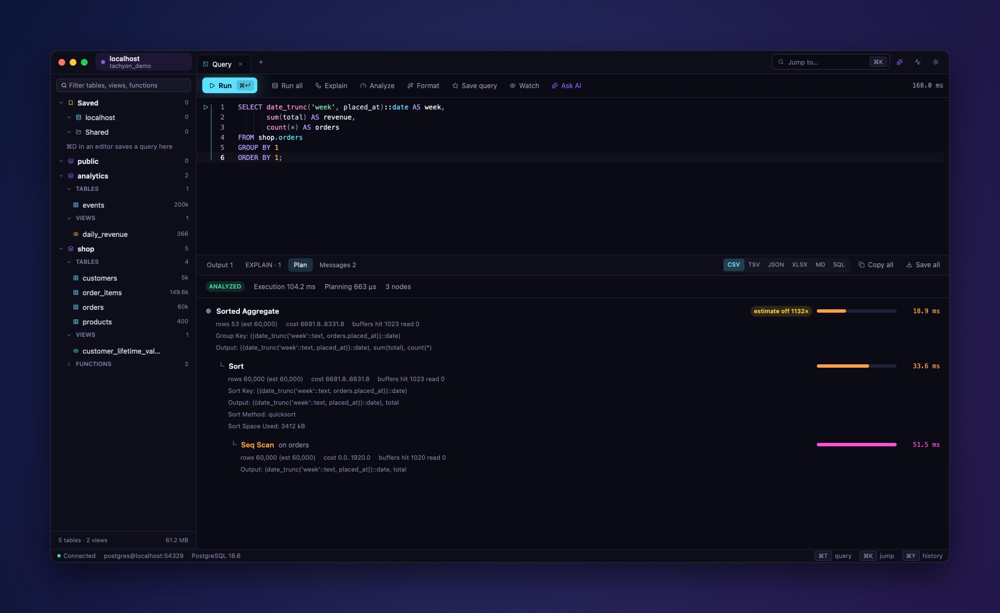

 

## AI that respects your data

Open **AI Assist** with ⌘J and ask about your data in plain English. Or use **Ask AI** on the query in front of you:

- **Explain** what a query does, step by step.
- **Optimize** it, with the tables, indexes and query plan sent along so the answer fits your database.
- **Fix** an error, offered first whenever a query fails.
- **Add comments** to a long query.

Suggestions replace your query as one undoable edit, and nothing runs until you run it. AI can read your schema and, only if you allow it, run read-only queries that are always rolled back. You see exactly where your prompts go.

Bring your own key for **Anthropic**, **OpenAI**, **Google Gemini** or any OpenAI-compatible service, or keep everything on your Mac with **Ollama** or **LM Studio**. Tachyon finds a local model server for you and can download a recommended model in one click.

**Use your databases from Claude and other AI tools.** Tachyon includes an MCP server, so clients like Claude Desktop and Claude Code can read schemas and run read-only queries on the connections you turn on, one by one. None are shared until you choose.

 

## Shape your schema

The **Structure** page puts everything about a table on one screen: columns, indexes with their size and usage, foreign keys in both directions, constraints, triggers, and health such as dead rows and the last vacuum. **Edit structure** changes columns, keys, indexes and constraints, and shows the SQL before anything runs. **New table** does the same from scratch.

The **schema diagram** draws every table and relationship. Pan, zoom, find a table, drag cards around, and double-click to open one.

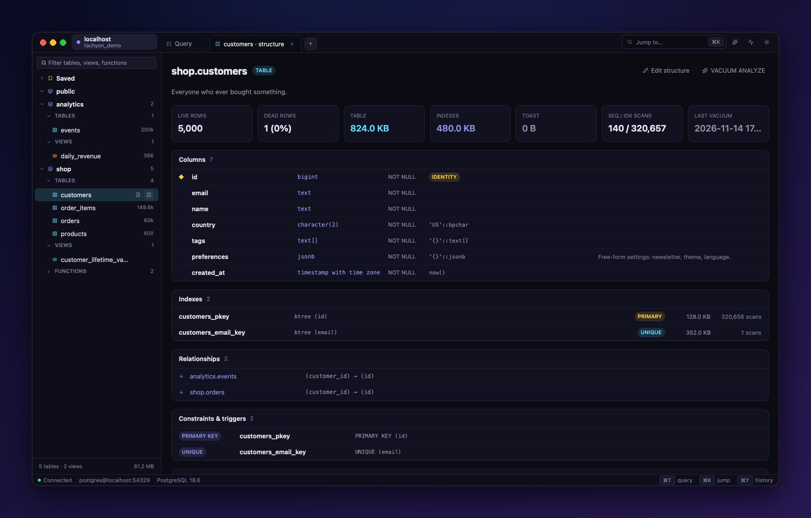
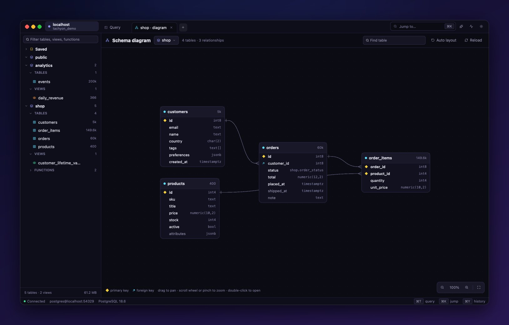

 

## Maps for your spatial data

Run a query with PostGIS geometry or geography and switch to **Map**. Hundreds of thousands of features draw instantly on a built-in basemap that works offline. Hover for details, and click a feature to jump to its row.

- **Style it your way.** Color by any column with categories, smooth ramps, natural breaks or quantiles. Add graduated symbols, labels, heatmaps, hexbins and clusters.
- **Layers.** Pin results and add tables, then reorder, restyle and toggle them.
- **Explore.** Measure distance and area, draw a box, polygon or radius to filter rows, and play dates back with a time slider. Export the map as PNG or SVG.
- **Spatial tools.** Buffer, points in polygons, nearest neighbors, within distance, dissolve, clip, hulls, simplify, reproject, clustering, hex and grid binning, and more. Set a distance in meters, miles or feet and Tachyon writes the PostGIS for you. Read-only tools land straight on the map; anything that changes data only goes into the editor.
- **49 GIS recipes.** Ready-made, documented queries for everyday analysis, filled in with your own tables.
- **Import spatial files.** GeoJSON, Shapefile, KML, GPX and CSV with coordinates, with a map preview, coordinate system detection and a spatial index created for you.
- **Spatial insight everywhere.** PostGIS autocomplete and docs, readable WKT, EWKT and GeoJSON in the inspector, geometry types, SRIDs and extents for every table, and a warning with a one-click fix when a big table has no spatial index.

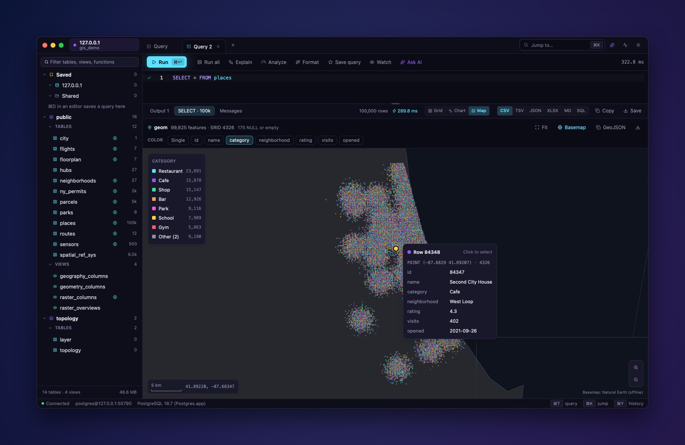
 
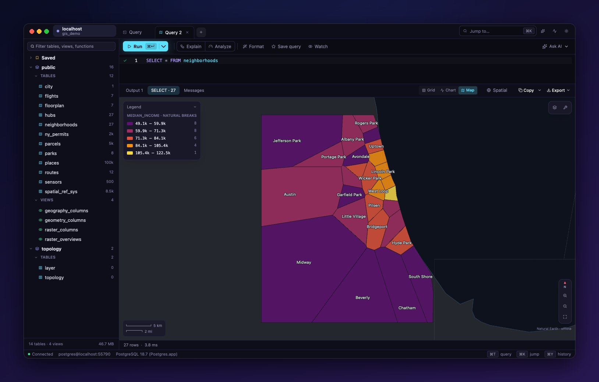
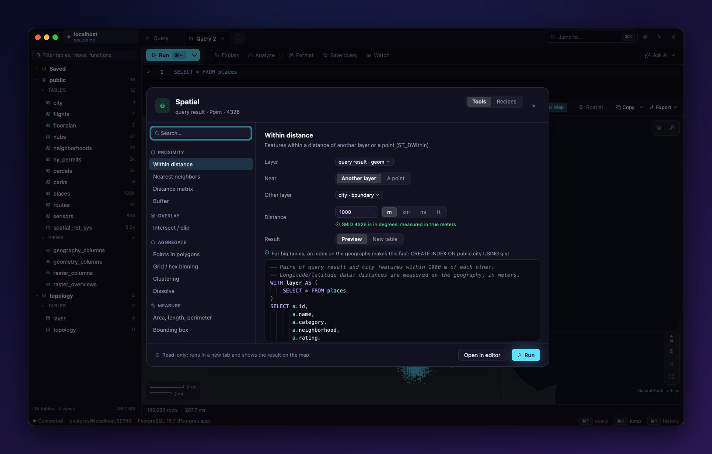

 

## Databases on this Mac, one click away

Tachyon finds Postgres, Redis and Valkey running in Docker, OrbStack, Podman and Colima, plus Postgres.app and Homebrew servers, and connects with the container's own settings. No ports or passwords to look up. New to Postgres? Try the built-in sample database.

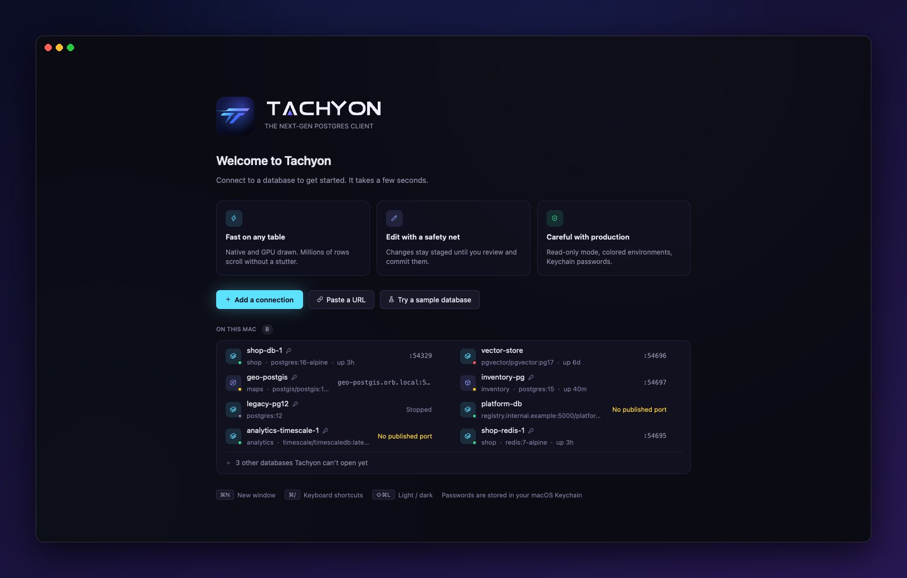

 

## Redis and Valkey too

Connect with a `redis://` or `valkey://` link, or in one click from **On this Mac**. Passwords, ACL users, TLS and SSH tunnels all work.

- **Browse keys** in a tree grouped by prefix, with type, size and expiry at a glance. Search by pattern and filter by type.
- **Look inside any key.** Strings as text, a folding JSON tree or hex. Hashes, lists, sets, sorted sets and streams each get a view made for them, with stream consumer groups too.
- **Edit safely.** Changes are staged and shown as the exact commands before they run.
- **Keyspace analysis** shows where your memory goes: by type, by key pattern such as `user:*:session`, the biggest keys, and how much is set to expire. Export the report as CSV or JSON.
- **Server dashboard** with live operations per second, memory, hit ratio, clients, persistence and replication, plus the slow log, connected clients, latency and configuration.
- **Console** with autocomplete for every command, and AI Assist that knows Redis.
- **Safe by default.** Anything that changes data asks first, and commands that wipe or stop a server need you to type their name.

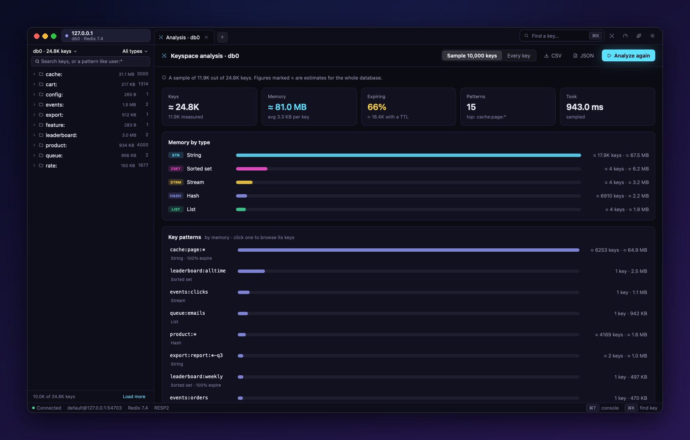
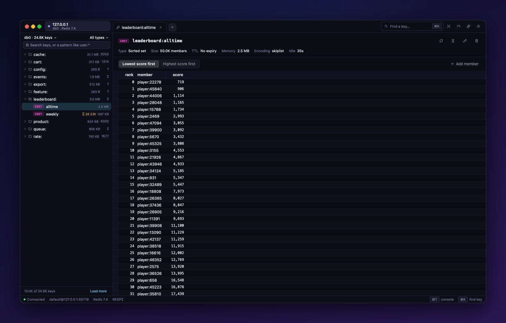

 

## Everything a pro needs

| | |
|---|---|
| **Charts** | Turn any result into a line, area, bar, scatter or pie chart in one click, even with hundreds of thousands of rows. |
| **Roles & privileges** | Create and change roles and memberships, and grant table, column and default privileges, with every change previewed first. |
| **Backup & restore** | Back up and restore databases, schemas or single tables, with live progress and the command shown before it runs. |
| **Run SQL files** | Run a dump or migration statement by statement, with progress, stop or carry on after errors, and an optional all-or-nothing transaction. |
| **Schema compare** | See exactly what differs between two databases and get the migration script. Nothing runs by itself. |
| **Activity monitor** | Live connections and running queries, who is blocking whom, and one click to cancel or stop a query. |
| **Saved queries & history** | Keep queries as plain `.sql` files in folders you can also edit outside the app. ⌘Y searches everything you've ever run, on every connection. |
| **Import & export** | Import CSV, TSV and spatial files into a new or existing table. Export results as CSV, TSV, JSON, Excel, Markdown, SQL or GeoJSON. |
| **Secure connections** | Reach private networks through SSH using your existing config, keys, agent and jump hosts, with host keys verified. SSL with your own CA. |
| **Safe production** | Read-only connections, colored environment labels, and passwords and API keys in your macOS Keychain. |
| **Command palette** | ⌘K jumps to any table, view or function, runs any command, and reopens saved and past queries. Every shortcut can be changed. |
| **Keyboard first** | Arrow keys move through the sidebar, results and every list. Shift-arrows select a range of cells, ready to paste into a spreadsheet. |
| **Tabs & windows** | Pin tabs, split the editor, open several windows, and get a notification when a long query finishes while you're elsewhere. |
| **iCloud sync** | Optionally keep your saved connections in sync across your Macs through iCloud Drive. |
| **Themes & sizes** | Built-in light and dark themes, or make your own. Tachyon picks a comfortable size for each display, and ⌘+ and ⌘− fine-tune it. |

 

## Dark and light

Tachyon follows your Mac's appearance, or pick a theme of your own. Toggle any time with ⇧⌘L.

<table>
<tr>
<td width="50%">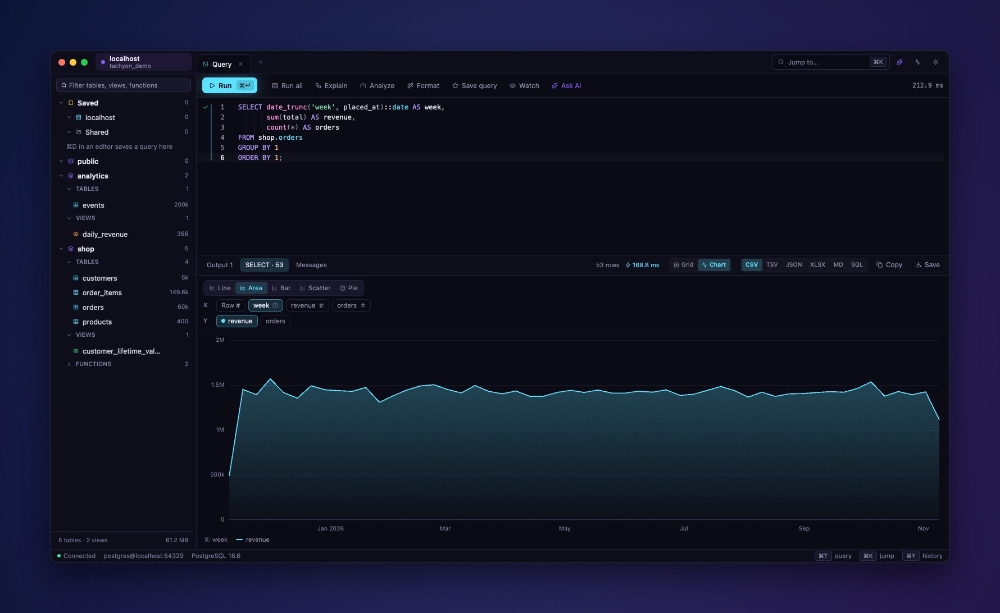</td>
<td width="50%">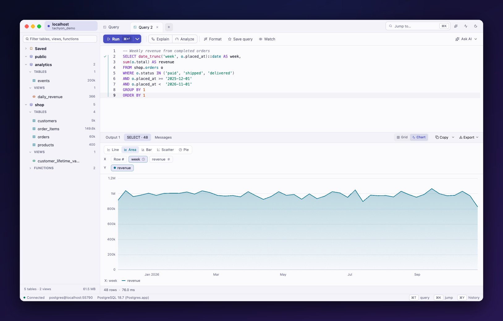</td>
</tr>
</table>

 

## Install

1. [Download the latest release](https://github.com/mccannjustin17/tachyon-releases/releases/latest) (`Tachyon-<version>.dmg`).
2. Open it and drag **Tachyon** into your **Applications** folder.
3. Open Tachyon and connect: pick a database found on your Mac, paste a `postgres://` or `redis://` URL, add a connection, or try the built-in sample database.

Tachyon is signed and notarized by Apple. It's in early access, and every feature is unlocked.

**Requirements:** macOS 12 Monterey or later, on Apple silicon or Intel. Works with PostgreSQL, Redis and Valkey servers on your Mac, on your network or in the cloud, over SSL and SSH.

## Updates

Tachyon checks this page for new versions and offers to install them for you. Every download is verified against its published SHA-256 checksum and the developer's signature before it's installed. You can turn automatic checks off in **Settings**, or check any time with **Tachyon › Check for Updates…**

See what changed in each version on the [releases page](https://github.com/mccannjustin17/tachyon-releases/releases).

## Privacy

Tachyon has no account, no analytics and no tracking. It only talks to:

- **Your databases**, directly or through the SSH hosts you configure.
- **The AI provider you choose**, if you turn AI on, and only with what you allow it to read. Local models never leave your Mac.
- **iCloud Drive**, only if you turn on connection sync.
- **GitHub**, to check for updates (you can turn this off).

Map basemaps are built in, so maps work offline. Passwords and API keys are stored in your macOS Keychain, never in plain files.

## Feedback & support

Found a bug or have an idea? [Open an issue](https://github.com/mccannjustin17/tachyon-releases/issues/new/choose). For security reports, please see [SECURITY.md](SECURITY.md).

 

© 2026 Tachyon. All rights reserved. PostgreSQL is a trademark of the PostgreSQL Community Association of Canada. Redis is a trademark of Redis Ltd. Mac and macOS are trademarks of Apple Inc.

