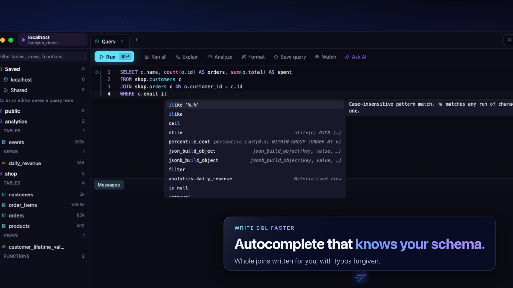
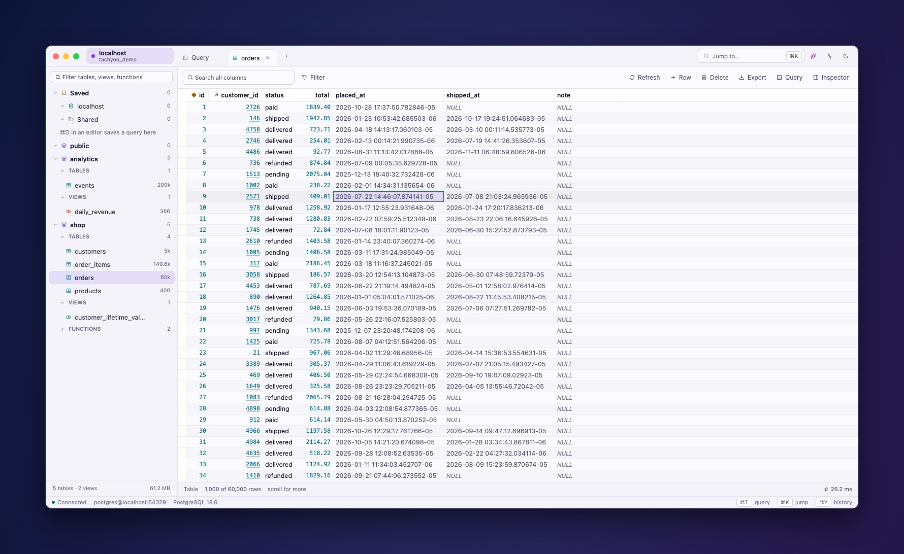

 
 

<picture>
  <source media="(prefers-color-scheme: dark)" srcset=".github/assets/wordmark-on-dark.svg">
  
</picture>

### The next-gen Postgres client for Mac

Fast, beautiful and built for people who live in their database.

 

 
 

 
 

 

## Why Tachyon

<table>
<tr>
<td width="50%" valign="top">

### ⚡ Built for speed
Opens in a blink and stays out of your way. Results stream in the moment they're ready, and tables with millions of rows scroll without a stutter. Truly native, with almost no CPU while idle.

</td>
<td width="50%" valign="top">

### ✍️ Write SQL faster
Autocomplete that knows your schema, whole joins written for you, typos forgiven. Mistakes are caught as you type, with one-key fixes and docs on hover for every table, column and function.

</td>
</tr>
<tr>
<td width="50%" valign="top">

### 🔍 See your data
Filter any column in a click, see what's inside it at a glance, and turn rows into charts. A visual query plan points straight at the slow parts, and your whole schema is drawn as a diagram.

</td>
<td width="50%" valign="top">

### 🛡️ Edit with confidence
Change values inline, then review every edit before it's saved. Read-only connections, colored environments and passwords in your macOS Keychain keep production safe.

</td>
</tr>
<tr>
<td width="50%" valign="top">

### ✨ AI that respects your data
Bring your own AI: a leading provider or a private model running on your Mac. It reads only what you allow, and every change waits for your OK.

</td>
<td width="50%" valign="top">

### 🍎 At home on your Mac
Light and dark, native menus, familiar shortcuts, a command palette for everything and beautiful themes.

</td>
</tr>
</table>

 

 

## Everything a pro needs

| | |
|---|---|
| **Table designer** | Add and change columns, keys, indexes and constraints, with the SQL shown before anything runs. |
| **Roles & privileges** | Manage roles, memberships, table, column and default privileges. |
| **Backup & restore** | Back up and restore databases, schemas or single tables. |
| **Schema compare** | See exactly what differs between two databases and get the migration. |
| **Activity monitor** | Live connections and running queries, who is blocking whom, and one click to cancel or stop a query. |
| **Secure SSH** | Connect through bastion hosts using your existing SSH config and keys. |
| **Import & export** | Import CSV and TSV files; export results as CSV, TSV, JSON, Excel, Markdown or SQL. |
| **Saved queries & history** | Keep queries as plain `.sql` files, and find anything you've run before. |

 

 

## Install

1. [Download the latest release](https://github.com/mccannjustin17/tachyon-releases/releases/latest) (`Tachyon-<version>-universal.zip`).
2. Unzip it and drag **Tachyon** into your **Applications** folder.
3. Open Tachyon and connect: paste a `postgres://` URL, add a connection, or try the built-in sample database.

> [!NOTE]
> Early releases are not yet notarized by Apple. The first time you open Tachyon, macOS will stop it: go to **System Settings › Privacy & Security**, click **Open Anyway** next to Tachyon, and confirm. On macOS 14 and earlier you can instead Control-click the app and choose **Open**.

**Requirements:** macOS 12 Monterey or later, on Apple silicon or Intel. Works with PostgreSQL servers on your Mac, on your network or in the cloud, over SSL and SSH.

## Updates

Tachyon checks this page for new versions and offers to install them for you. Every download is verified against its published SHA-256 checksum before it's installed. You can turn automatic checks off in **Settings**, or check any time with **Tachyon › Check for Updates…**

See what changed in each version on the [releases page](https://github.com/mccannjustin17/tachyon-releases/releases).

## Privacy

Tachyon has no analytics and no tracking. It only talks to:

- **Your databases**, directly or through the SSH hosts you configure.
- **The AI provider you choose**, if you turn AI on, and only with what you allow it to read.
- **GitHub**, to check for updates (you can turn this off).

Passwords and API keys are stored in your macOS Keychain, never in plain files.

## Feedback & support

Found a bug or have an idea? [Open an issue](https://github.com/mccannjustin17/tachyon-releases/issues/new/choose). For security reports, please see [SECURITY.md](SECURITY.md).

 

© 2026 Tachyon. All rights reserved. PostgreSQL is a trademark of the PostgreSQL Community Association of Canada. Mac and macOS are trademarks of Apple Inc.

